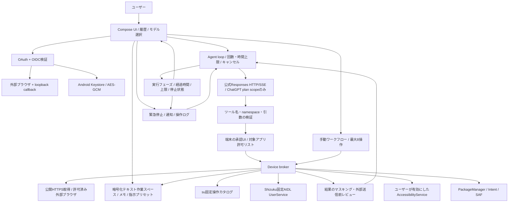

# 設計

## コンポーネント

## 権限モデル

- 通常: INTERNETでAIに接続。通常モードのパッケージ列挙はlauncherアプリに限定。SAFはユーザーが選択したURIだけ。v0.2.0の全アクセスモードは本人の明示opt-in後に非launcherを含むインストール済みアプリを検索対象にする。共有ストレージの一覧には別途OS権限が必要。[アクセスモード](access-modes.md)
- 画面: Accessibilityの説明とアプリ側の対象許可リストを設定した後、OS設定からユーザーが明示的に有効化。サービスの存在だけでは操作を許可しない。実行中フラグと操作ごとの承認も必要。
- Shizuku: binder生存・v11以降・permissionを毎回チェック。権限ダイアログはユーザーのボタン操作からだけ起動。UserServiceに任意command引数は存在しない。
- Root: root管理アプリをインストール・設定変更しない。ユーザーのopt-in後に固定操作を実行。許可済みアプリの内部データ一覧・端末内コピーと、一般アプリへのforce-stopを提供。システムアプリの停止・システムファイル変更・uninstall・権限変更は実装しない。Root設定の有効と実UID確認を別に表示する。[Rootファイル操作の詳細](root-file-operations.md)
- 操作承認はツールcall ID・引数・対象に対応する1回限り。自動承認、画面からの承認、モデルからの承認は認めない。
- 外部アプリでの確認はAccessibility overlayを使い、対象アプリを切り替えずに表示。古いsnapshotに対する操作は、画面の再検証で拒否する。

## ツール契約

namespaceは`android`。未知のnamespace、未知ツール、余分なキー、型不一致、範囲外、古いsnapshotを拒否。JSONからshellへ直接転送しない。

v0.4.0は `workspace_list/read/write/delete/search`、`read_selected_document`、`open_url`、`fetch_web_page` を追加した。型・上限・version照合・個別承認は [作業スペースとワークフロー](workspace-and-workflows.md) を参照。無効にしたツールはAI向けschemaから除外し、実行器でも拒否する。手動ワークフローはAI接続を経由せず同じ実行器へ渡す。

| 名前 | 引数 | 必要条件 |
|---|---|---|
| search_apps | query:string | launcher結果の外部送信を確認 |
| open_app | package:string | launcherあり、対象許可、実行確認 |
| open_settings | page:enum | 許可された設定ページ、実行確認 |
| list_files | なし | SAFで選択された項目の情報のみ、送信確認 |
| list_directory | path:string | 全モード＋OSファイル許可、共有ストレージ内の一覧情報のみ、送信確認 |
| list_app_data | package:string, path:string | Root、対象許可、実行確認、内部データ一覧情報のみ、送信確認 |
| copy_app_data | package:string, source_path:string, destination:string, format:directory/tar | Root、対象許可、コピー元と新しい保存先を個別承認、内容は端末内に保存、結果情報の送信確認 |
| read_screen | なし | Accessibility、対象許可、マスキング、送信確認 |
| tap_element | snapshot_id:string, element_id:string | snapshot一致、対象許可、実行確認 |
| swipe_screen | snapshot_id:string, direction:enum | snapshot一致、限定距離・時間、実行確認 |
| scroll_screen | snapshot_id:string, direction:enum | snapshot一致、実行確認 |
| input_text | snapshot_id:string, element_id:string, text:string | password不可、機密らしい入力不可、実行確認 |
| navigate_back / navigate_home | なし | 対象許可、実行確認 |
| check_root_status | なし | root opt-in、固定id確認、実行確認 |
| check_shizuku_status | なし | binder状態を返す |
| system_diagnostics | なし | Shizuku許可、固定UserService、送信確認 |
| force_stop_app | package:string, backend:enum | 対象許可、root opt-inまたはShizuku許可、影響を示す個別承認 |

結果はtool outputのJSON文字列。画面・ファイル等は`untrusted_observation`と明示。マスキングは完全なDLPを保証しないため、送信前に人間が編集・拒否できる。全ツール結果を送信前に確認し、拒否時は結果本体を履歴にもAIにも保存しない。

## 実行制限

1回のユーザー送信につき最大8ツール、最大12推論ラウンド、全体10分、通常ツール本体10秒、Root一覧30秒、Rootコピー190秒（UID確認を含む。コピー本体180秒）、承認60秒、HTTP接続20秒。並列tool実行はしない。全体キャンセルはHTTP Call.cancel、coroutine cancellation、保留承認の破棄、未実行ツール破棄を行う。Rootコピーでは実行許可ファイルを失効させ子プロセスを停止する。開始済み操作や部分コピーを巻き戻すとは主張しない。

SSEはresponse.completedを受けるまでtool callを確定しない。途中失敗時はゼロ件実行。履歴再送は暗号化ローカル履歴から作成し、reasoning等を含む返却outputも保持する。履歴サイズ上限時は新しい会話を案内する。

実行状態は単一のRunTrackerで管理し、generationで古いcallbackを拒否する。停止処理へ入った後の遅延callbackで「動作中」へ戻さず、完了・失敗・キャンセルを区別する。Compose、通知、Accessibility停止ボタンでフェーズを共有する。百分率は計測していないため表示しない。

短い処理や起動直後のキャンセルでforeground serviceを開始前にstopするとOSが後からプロセスを落とす場合があるため、操作・認証サービスはstartForeground完了のackを待つ。開始待ち中に中止した場合もservice自身がforegroundへ移ってから終了する。古いserviceの終了が新しい端末操作を停止しないようsessionを照合する。これは新しい認証方式を導入する変更ではない。

プロセス再起動時に未解決のtool callを結果不明として閉じ、実行中カードを中断表示へ変更する。旧操作を自動リプレイしない。輸入したチャットJSONは表示専用で、認証情報・providerのtool historyを受け付けない。

## 認証と送信境界

OIDC discovery/JWKSは固定のauth.openai.comからHTTPSで取得し、別hostへの誘導を拒否。維持されたJWTライブラリを使う。loopback listenerは127.0.0.1の動的port、GET /auth/callbackのみ、stateとPKCEで認証し、短時間で閉じる。ここにはAndroid操作APIを公開しない。

保存はKeystore AES-GCM鍵とアプリprivate領域の暗号化ファイル。履歴、認証、操作ログのbackupは禁止。ログはツール名・結果コード・時刻のみで、引数や画面情報、token、コード、入力文は記録しない。パスワード入力欄・edit欄は画面読み取りから除外し、メール・カード形式・OTP等の機密パターンをマスクする。

作業スペース、本人管理メモ、指示プリセット、ワークフローとUI設定もvaultへ保存する。本人がSAFで選んで書き出すファイルは、平文となることを表示してから保存先を選ぶ。Web取得にはOpenAI認証clientを流用せず、Cookieや認証情報のない別clientを使う。音声入力は端末内専用recognizer、読み上げはインストール済み端末内音声だけで、クラウドfallbackを用意しない。

各認証登録をclient IDと検証済みsubで分離し、host IDを維持する。サインアウトはrefresh tokenの失効を試み、ネットワーク失敗時はリモート失効未確認を表示してローカルtokenを削除する。

## 対象外と未検証

初期版は利用中のforegroundセッションだけ。常時自律運転、通知監視、SMS、連絡先、カメラ、位置情報、アカウントcookie、画面の継続録画、任意shellを提供しない。AI向け画面情報はマスキング可能なAccessibility UIツリーとして取得する。Phase AのMediaProjectionはOSの都度許可に基づく1枚の端末内プレビューで、画像はメモリ内のみ、外部送信しない。画像の完全な機密マスキングを保証できないため、画像添付は初期版に含めない。
