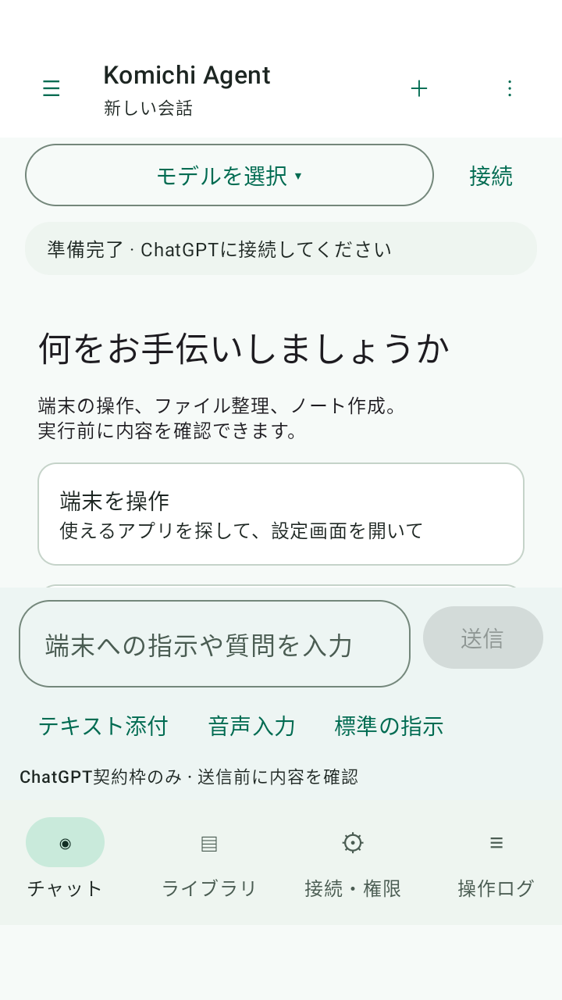
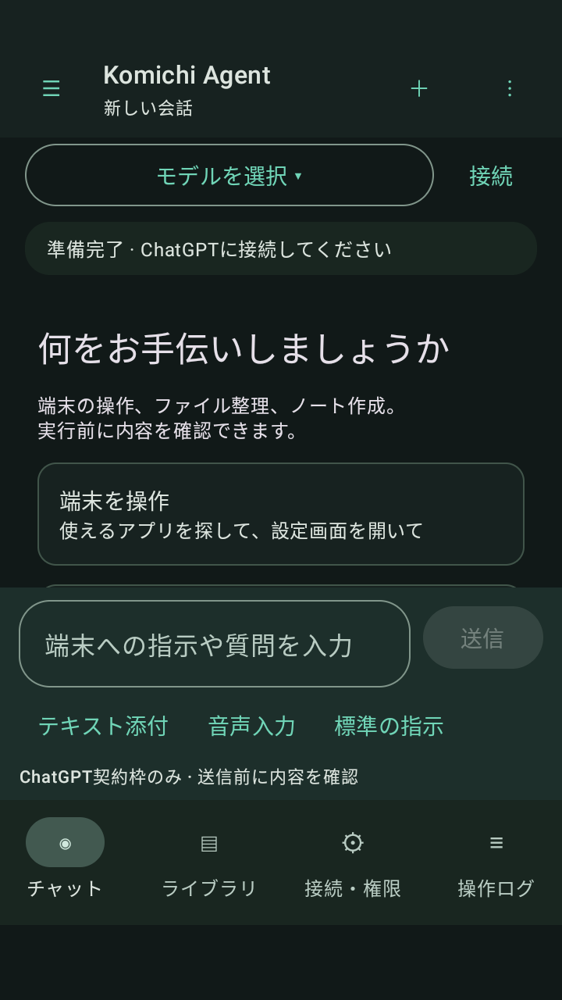
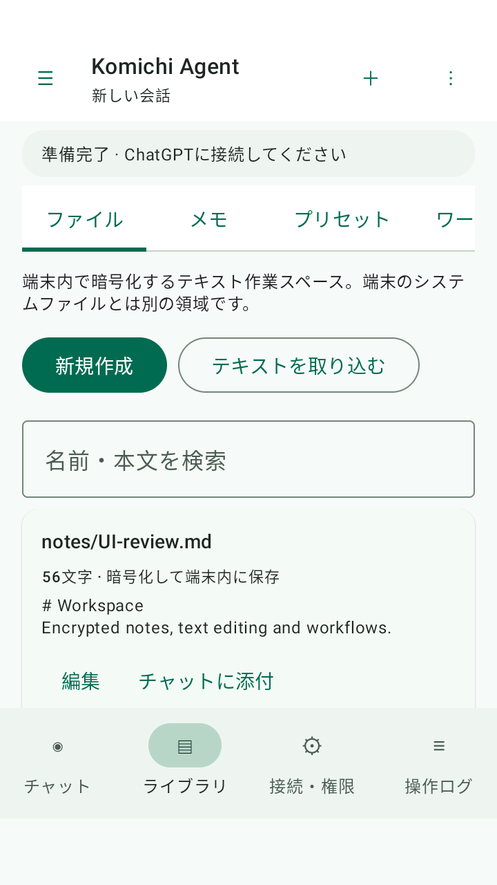
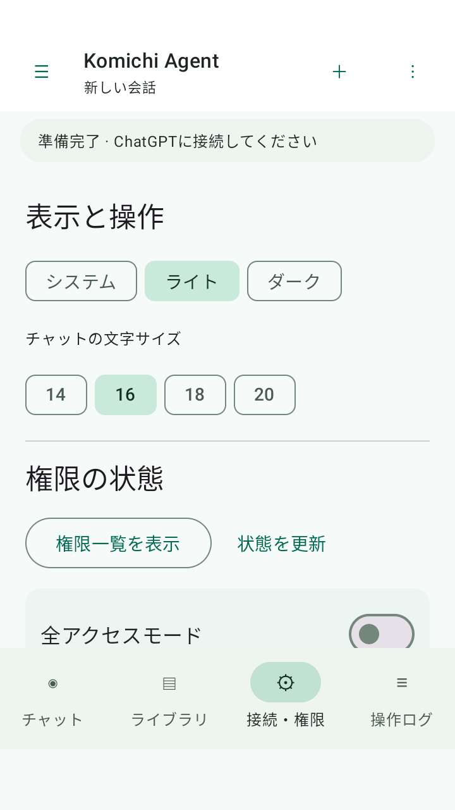

# v0.4.0 UIプレビュー

使い捨てAndroid 11エミュレーター上の人工データによる画面。実アカウントや利用者の情報は含まない。画像取得のためテスト中だけFLAG_SECUREを外し、終了時に戻した。通常のAPKはFLAG_SECUREを維持する。

| チャット（ライト） | チャット（ダーク） |
|---|---|
|  |  |

| 作業スペース | 設定 |
|---|---|
|  |  |

操作時はモデル欄の下に「動作中」と現在のフェーズ・経過時間・操作回数・停止ボタンを表示する。承認ダイアログを待っている間も動作状態を維持し、完了・失敗・停止で終了表示に切り替える。Androidテストでは実際の承認待ち・保存完了・拒否・停止処理を確認した。
